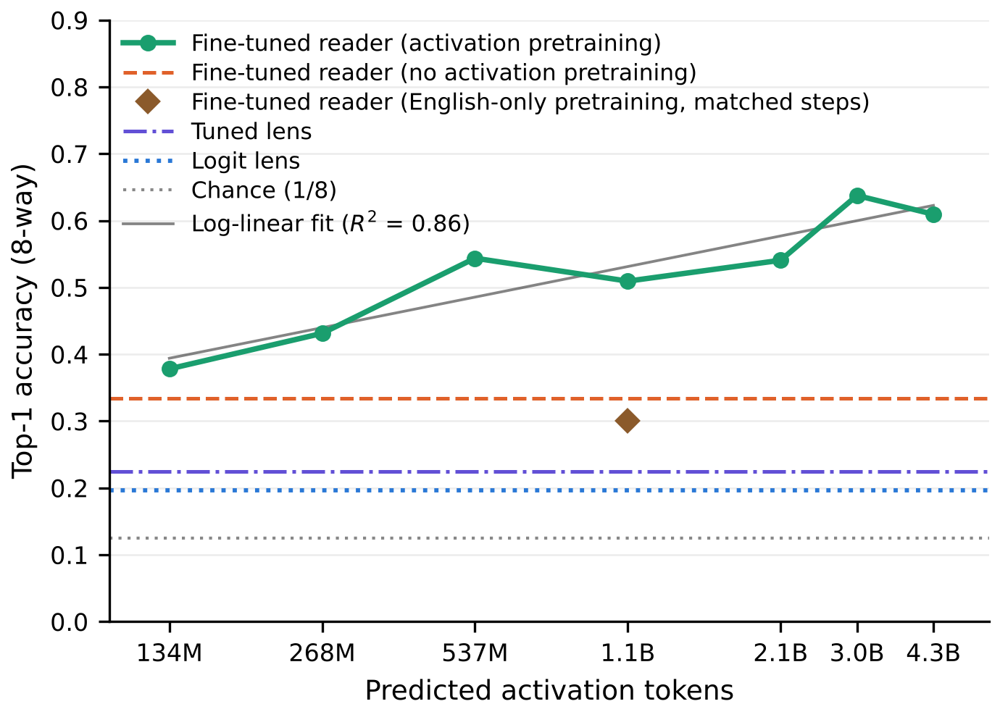

# Activation prediction pretraining
Preliminary results (Nov 17, 2026). Full writeup in progress

**Figure 1:** *This plot shows initial results with activation-prediction-based pretraining for improved activation interpretation and monitoring.  Fine-tuning results are shown with and without this pretraining, where the fine-tuning used a fixed 61k-pair self-supervised prompt-prediction task, ie learning to predict prompts from activations.  We can see from the plot that increased pretraining with activation prediction steadily improves the capacity to guess hidden words based on activations, in a model organism finetuned to keep 8 secret words.  With 4.3 billion activation tokens in pretraining, our activation reader gets ~60% accuracy at ranking the hidden word top-1 of the 8 options, versus 33% with no activation pretraining (with chance on these 8 words at 12.5%).  Also, we can see that the approach beats various standard baselines, including a tuned lens fitted on the model organism, as well as an English-only control with the same pretraining text but no activation-prediction objective, to verify that activation prediction was itself providing the benefit.* 

## Prior work

There has been prior work on generating or predicting LLM activations, but none that we are aware of performs autoregressive activation prediction and uses this activation-prediction task as an additional pretraining step for an LLM in order to improve activation interpretation.  The generative meta-model approach (Luo et al., 2026) trains a generative diffusion model to model activations, but the weights are not shared with an LLM, so there is not direct transfer to LLM-based activation verbalizers/oracles; instead they use the features from the diffusion model as inputs to probes and steering.  Another approach, Context–Answer Metamodels (He & Jiralerspong, 2026) train MLPs, flow models and other approaches to predict pooled activations as opposed to sequential autoregressive prediction, and again these predictive models are separate from the LLM itself, and do not transfer activation interpretability into the LLM, but rather provide predicted (pooled) activations as inputs for linear probes.  Future Lens (Pal et al., 2023) involves activation prediction with linear models, for the purposes of predicting future outputs; but the linear maps are trained to predict actual future outputs, so it's not an approach for eliciting potentially hidden information in the activations (unlike oracles, etc).  Also, one approach that does auto-regressively predict activations is the EAGLE (Li et al., 2024) speculative sampling paper, but the purpose in this case was to provide speed efficiency gains, not improve interpretability.  A related proposal comes from Transluce's blogpost on their research vision (Steinhardt, 2026) which suggests potential training approaches for oversight foundation models, with various example targets including "activation prediction"; they don't define this phrase or discuss prediction of activations from other activations (as opposed to predicting activations from prompts, etc); note this Transluce researcher (Steinhardt) was a coauthor on the paper above on diffusion-based activation modeling (Luo et al., 2026). 

There has been substantial work on training models to act as activation verbalizers, for extracting open-ended english descriptions from activations, and these approaches are potential use-cases for applying our activation pre-training step to improve the results.  The LatentQA approach (Pan et al., 2024) trains an LLM to answer questions about the activations, with training questions based on the prompt that led to those activations. Activation Oracles extend this with self-supervised prompt prediction tasks and other modifications and show transfer to hidden information from fine-tuned organisms (Karvonen et al., 2025; Bauer et al., 2026).  There have been substantial efforts to scale Activation Oracles to large models (Choi et al., 2026), which find substantial improvements but also that transfer to some downstream interpretation seems to eventually plateau or worsen, even as the training loss continues to improve (Bauer et al., 2026).  However, note that these activation oracle approaches are generally predicting english tokens (related to the prompt), not predicting activations as in our approach.  Predictive Concept Decoders (Huang et al., 2025) are an Activation-Oracle adjacent approach that rely on a substantial pretraining stage, analogous to our approach, however this pretraining is based on predicting english tokens rather than modeling the activations themselves.  Natural Language Autoencoders, NLAs (Fraser-Taliente et al., 2026), are another related approach to activation verbalizers that rely on back-translation, with an auto-encoder that maps activations to english summaries and then back to activations again; so this approach does map english to activations, but this is a deterministic map learned based on squared-error reconstruction loss to match the input activations, and unlike our approach they don't learn a sequential autoregressive model of activations from previous activations, and in their approach the decoder that produces those activations is a separate model, so lacking shared weights and transfer to the autoregressive LLM that generates the english summaries.

One of the core approaches that we use as a standard linear baseline is a logit lens (nostalgebraist, 2020), which was applied to hidden word (Taboo) organisms in Cywiński et al., 2025; this was also a baseline for the Activation Oracles paper.  While the logit lens is untrained, we also include a trained version, known as a tuned lens (Belrose et al., 2023) as an additional baseline. 

## Clarifications and Caveats:

1. In addition to the simple prompt-prediction fine-tuning we also tried replicating the fine-tuning training data from the original activation oracle paper, but surprisingly the simple activation-to-prompt fine-tune task gave better results for this model/task, at this 0.6B scale.  
2. Note this activation pretraining approach is not specific to activation oracles, and it could be interesting to test this pretraining with other methods e.g. natural language autoencoders.
3. Also, the current activation reader (and model organism) is just a 0.6B Qwen model, which is quite small, and an upcoming priority is to test activation pretraining with larger models (e.g. 8B) to see how it scales with model size.
4. We currently test with one family of model organisms with 8 hidden words, where the current hidden word depends on LLM context; this reflects a realistic setting where the target model's deceptive behavior varies with context.
5. These tests are so far mostly with one seed each, so additional random seeds should be tested.
6. The above plots are with a fixed fine-tuning budget; we have some data at increasing fine-tuning scales, but further experiments will be needed to assess whether the pretraining gains could be achieved with sufficient fine-tuning scale.

## References

## References

- Bauer, J., De Schamphelaere, C., Karvonen, A., Luick, N., & Nanda, N. (2026). [Building Better Activation Oracles](https://arxiv.org/abs/2606.02609). arXiv:2606.02609; ICML 2026 Workshop on Mechanistic Interpretability.
- Belrose, N., Ostrovsky, I., McKinney, L., Furman, Z., Smith, L., Halawi, D., Biderman, S., & Steinhardt, J. (2023). [Eliciting Latent Predictions from Transformers with the Tuned Lens](https://arxiv.org/abs/2303.08112). arXiv:2303.08112.
- Choi, D., Huang, V., Mudide, A., Zhou, W., & Steinhardt, J. (2026). [Scaling Activation Oracles to Trillion-Parameter Models](https://transluce.org/scaling-activation-oracles). Transluce, August 2026.
- Cywiński, B., Ryd, E., Wang, R., Rajamanoharan, S., Nanda, N., Conmy, A., & Marks, S. (2025). [Eliciting Secret Knowledge from Language Models](https://arxiv.org/abs/2510.01070). NeurIPS 2026.
- Fraser-Taliente, K., et al. (2026). [Natural Language Autoencoders Produce Unsupervised Explanations of LLM Activations](https://transformer-circuits.pub/2026/nla/). Transformer Circuits, May 2026.
- He, T., & Jiralerspong, T. (2026). [Context–Answer Metamodels: Forecasting LLM Activations Before the First Answer Token](https://arxiv.org/abs/2611.06837). NeurIPS 2026 Workshop on Neural Network Artifacts as a New Data Modality (NeuralArtifacts).
- Huang, V., Choi, D., Johnson, D. D., Schwettmann, S., & Steinhardt, J. (2025). [Predictive Concept Decoders: Training Scalable End-to-End Interpretability Assistants](https://arxiv.org/abs/2512.15712). NeurIPS 2026.
- Karvonen, A., Chua, J., Dumas, C., Fraser-Taliente, K., Kantamneni, S., Minder, J., Ong, E., Sen Sharma, A., Wen, D., Evans, O., & Marks, S. (2025). [Activation Oracles: Training and Evaluating LLMs as General-Purpose Activation Explainers](https://arxiv.org/abs/2512.15674). ICML 2026.
- Li, Y., Wei, F., Zhang, C., & Zhang, H. (2024). [EAGLE: Speculative Sampling Requires Rethinking Feature Uncertainty](https://proceedings.mlr.press/v235/li24bt.html). ICML 2024.
- Luo, G., Feng, J., Darrell, T., Radford, A., & Steinhardt, J. (2026). [Learning a Generative Meta-Model of LLM Activations](https://arxiv.org/abs/2602.06964). ICML 2026.
- nostalgebraist (2020). [Interpreting GPT: the logit lens](https://www.lesswrong.com/posts/AcKRB8wDpdaN6v6ru/interpreting-gpt-the-logit-lens). LessWrong.
- Pal, K., Sun, J., Yuan, A., Wallace, B. C., & Bau, D. (2023). [Future Lens: Anticipating Subsequent Tokens from a Single Hidden State](https://arxiv.org/abs/2311.04897). CoNLL 2023.
- Pan, A., Chen, L., & Steinhardt, J. (2024). [LatentQA: Teaching LLMs to Decode Activations Into Natural Language](https://arxiv.org/abs/2412.08686). ICLR 2026.
- Steinhardt, J. (2026). [Foundation Models for Oversight](https://transluce.org/foundation-models-for-oversight). Transluce, July 2026.
